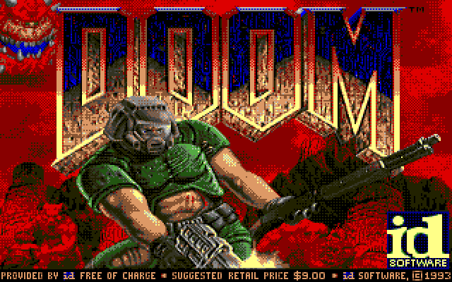

# MD/DOOM



Microfirmware for the [SidecarTridge Multi-device](https://sidecartridge.com) by [Neil Rackett](https://neilrackett.com/atarist)

## Introduction

The SidecarTridge Multi-device is brilliant, but can it run DOOM?

MD/DOOM brings full speed, fully playable Doom to your Atari ST via your SidecarT, in 16 colours on a colour monitor or in 640×400 on a mono monitor like the SM124. Sound effects use the STE DMA chip if you have one or the YM2149 if you don't, and with DMA sound the YM2149 plays Doom's music too (without it, you choose music or sound effects).

A big thanks to Graham Sanderson for [rp2040-doom](https://github.com/kilograham/rp2040-doom), which helped make this possible, and Jonas Eschenburg, whose [STDOOM](https://github.com/indyjo/STDOOM) colour palette MD/DOOM started out with.

## Installation

You can install MD/DOOM from the official [SidecarTridge Multi-device store](https://md-store.sidecartridge.com/#atari-st) using the Booster web app, or manually if you prefer. Either way you'll need to download the shareware level packs from the [releases page](https://github.com/neilrackett/md-doom/releases).

See below if you'd prefer to build alternative level packs yourself.

### Manual installation

1. Download the latest `.uf2`, `.json` and shareware level packs from the [releases page](https://github.com/neilrackett/md-doom/releases).
2. Copy both the `.uf2` and `.json` into the `/apps` folder of your SidecarT's microSD card, and extract all of the E1M\*.whx, D\_\*.MUS and GENMIDI.OP2 files into a `/doom` folder. The `.MUS` files and `GENMIDI.OP2` are the music: leave them out and the game just plays without it.
3. On the Booster screen, press ESC for the app list and select MD/DOOM.
4. To return to Booster, power on your ST while holding the SELECT button on your SidecarT.

Hold either **Shift** key while your ST powers on to skip the game and
boot to the desktop instead. MD/DOOM says so on the boot screen. From
the desktop you can start it again by opening the cartridge icon (the
lower-case `c` drive) and running **MDDOOM.TOS**.

MD/DOOM needs a fixed region of memory for its screens. Started from
the desktop, it checks that nothing else is using it first; if
something is (a resident program, a RAM disk), it says so and takes you
back to the desktop. Letting it start on its own from the cartridge
always works — it runs before the AUTO folder does.

Quitting restarts your ST and returns you to the desktop. MD/DOOM takes
the machine over completely while it runs, so there is nothing to hand
back to.

## Controls

Controls match the original PC Doom:

| Key             | Action                                                                             |
| --------------- | ---------------------------------------------------------------------------------- |
| ↑ ↓ ← →         | Move and turn (the keypad works too)                                               |
| Control         | Fire                                                                               |
| Space           | Use (doors, switches)                                                              |
| Alternate       | Strafe                                                                             |
| Shift           | Run                                                                                |
| 1 to 7          | Weapons                                                                            |
| Esc             | Menu                                                                               |
| Tab             | Automap                                                                            |
| F1 to F10       | Help (not supported), save (not supported), load (not supported), volume, detail (not supported), quick-save (not supported), end game, messages, quick-load (not supported), quit |
| Help            | Gamma (F11 on a PC)                                                                |
| Undo            | Pause                                                                              |
| - and +         | Screen size: the view with the status bar, or the full screen without it           |
| Keypad \*       | Cycle through the dither options (see below); your choice is remembered            |
| Keypad )        | On an ST without DMA sound: music or sound effects (see Music below); remembered   |

**Gamepad support is off in this release.** MD/DOOM can read an
[Xpad](https://github.com/neilrackett/atarist-xpad) gamepad, but only a
driver loaded from your AUTO folder can provide one, so it only works
when MD/DOOM is started from the desktop. That route used to crash with
anything resident, and gamepad support goes back on once the fix has
been proven on real hardware.

A joystick in port 1 moves, turns and fires. The mouse turns and walks,
with the **right** button to fire and the **left** button held to
strafe.

The mouse buttons are the other way round to a PC because of an ST
quirk: inside the machine, the right mouse button and the joystick's
fire button are the same wire, and while the mouse is switched on the
keyboard chip reports that wire as the right mouse button and never as
the joystick's trigger. So the right button has to be fire, or a
joystick could not shoot, and strafe goes to the left button instead.

Quit Game asks where to go: **Y** returns you to the desktop and **B**
restarts your ST into the SidecarT Booster, which saves powering off
and holding the SELECT button.

Quit from the menu (or pressing F10) asks whether to return to GEM or
go to the Booster.

The full screen size gives you the whole 320×200 for the game at the
cost of the status bar, exactly as the original did at its largest
setting; your choice is remembered. The sizes in between are not
available, because this renderer cannot draw a narrower view.

Dither options: nearest colour, 2×2 Bayer, 4×4 Bayer (default), blue noise.

The palette is adaptive: it picks the 16 colours for each frame from what is on screen. Dark corridors get dark shades and brown rooms get browns, so there is less dither and less colour cast than with a fixed palette. The status bar gets 16 colours of its own as well, switched in part-way down the screen.

### Mono monitors

On a mono monitor (the SM124, or anything else in ST high res) MD/DOOM
runs in black and white at 640×400. Every Doom pixel becomes a 2×2
block, but the dither works at the full resolution, so its pattern is
twice as fine as the picture. Keypad \* still cycles the dither options.
A mono screen refreshes at 71 Hz and copying a whole screen takes longer
than one of those, so the picture updates every other refresh: about 36 times a
second, which is still more often than the game itself moves on (35).

### Music

MD/DOOM plays Doom's music the way a PC with an AdLib or Sound Blaster did: the cartridge synthesises an OPL2 FM chip, with Doom's own instruments, and mixes it with the sound effects, so your ST plays both together. The songs are Doom's own (`D_E1M1.MUS` and so on) and the instruments are `GENMIDI.OP2`; they sit on your SD card next to the level packs, so they cost the game no flash. Without them there's simply no music, and the loading screen suggests downloading the latest level pack. The music volume in Doom's sound menu works as usual.

On an STE, or any other ST with DMA sound, the music and sound effects play through the DMA chip. A plain ST plays them through its YM2149, which manages a rougher version; press keypad ) there to turn the music off, and again to turn it back on. Your choice is remembered.

### Level packs

Your SidecarT has only got 1,152KB available for both code and data, and the smallest we can compress the shareware WAD to is 1,758KB, so MD/DOOM loads level packs one at a time (maximum ~768KB each), which contain just the map, sprites, textures, flats and sounds needed. We also had to drop the help and credits screens, have monsters that always face you, and sound effects at 5 kHz.

If you'd like to build the level packs yourself, you'll need [the `DOOM1.WAD` from the Shareware version of Doom](https://ia800601.us.archive.org/view_archive.php?archive=/26/items/doom-wads/Doom%20%28v1.9%29%20%28Demo%29.zip); it should work with the full level packs, but this is untested.

```bash
git clone --depth 1 https://github.com/kilograham/rp2040-doom /tmp/rp2040-doom
cmake -S tools/whd_gen -B build/whd_gen -DRP2040_DOOM_SRC=/tmp/rp2040-doom/src
cmake --build build/whd_gen
python3 tools/levelpack.py DOOM1.WAD packs --doom-src rp/src/doom/doom \
    --whd-gen build/whd_gen/whd_gen --no-ui --no-rotations --sfx-rate 5000
```

`levelpack.py` will report every pack's size against the budget, and writes the music files as well (`--no-music` leaves them out). To make just the music, for level packs you already have:

```bash
python3 tools/levelpack.py DOOM1.WAD packs --doom-src rp/src/doom/doom --maps none
```

Copy the `.whx`, `.MUS` and `GENMIDI.OP2` files into the `/doom` folder of your SD card.

## Hardware requirements

- [SidecarTridge Multi-device](https://sidecartridge.com) (RP2040-based ROM cartridge emulator)
- Atari ST, STE, MegaST, or MegaSTE, with a colour monitor (low res) or a mono one such as the SM124 (high res)
- A microSD card for the level packs (and the music)
- Raspberry Pi Debug Probe or Picoprobe for flashing/debugging (optional, for development)

## How it works

The RP2040 runs Doom on Core 0 at 400 MHz, rendering 320x200 bytes of palette indices. After every frame both cores map those through a 16-colour dither lookup and pack the ST's four bitplanes straight into the cartridge framebuffer, in the m68k's slack between one blit and the next; the m68k blits that to the ST screen every VBL. On a mono monitor the same 32,000 bytes hold a 640x400 one-bit picture instead, dithered at the full resolution, and the m68k copies it in two halves over two of the mono screen's 71 Hz VBLs. An ST without DMA sound copies in two halves too, as playing the sound effects on the YM2149 leaves too little of each VBL for the whole copy, so it shows up to 25 frames a second. Sound effects are mixed from a timer interrupt in step with the ST's VBL, so audio keeps up however long a frame takes. The same interrupt steps the music, read from the SD card a block at a time, and hands the m68k the YM2149's registers to write each VBL. Input, the palette and sound ride the cartridge bus in both directions.

```
IKBD keys + joystick       ──$FB82xx──►  demux → Doom events
Xpad gamepad buttons       ──$FB88xx──►  hi byte, then lo at $FB8Axx
Sound chip report (_SND)   ──$FB86xx──►  picks STE DMA or YM2149
Display report (mono?)     ──$FB90xx──►  picks 16 colours or 640x400 mono
Screen: blit + page flip   ◄──$FA8300──  256 → 16 colours + c2p, both cores
Palette: 16 shifter words  ◄──$FA4040──  chosen for each frame
Sound: DMA refill or YM    ◄──$FA4100──  8-channel sfx + OPL2 music on Core 1
```

## Building

Clone with `--recursive`, or run `git submodule update --init --recursive` before the first build.

```bash
# Production build (pico_w), UUID from uuid.txt
make build

# Debug build (bumps the patch version)
make debug

# Open a UART console on the debug probe
make uart
```

Flash and RAM are both nearly full; `AGENTS.md` has the budgets, the architecture notes and the improvements backlog.

### Running it on your computer

You can also run MD/DOOM on your Mac or Linux PC, no SidecarT required, using [EmuMD](https://github.com/neilrackett/emumd) in the `emu/emumd` submodule. It builds the firmware for your computer and runs it in a version of [Hatari](https://www.hatari-emu.org) with a Multi-device on its cartridge port, with a folder standing in for the microSD card. You'll need the tools in [EmuMD's README](https://github.com/neilrackett/emumd#getting-started) and the level packs (see above) in `emu/sd/doom`, then:

```bash
emu/emumd/tools/mdfw hatari            # once: builds EmuMD's Hatari, downloads EmuTOS
make emu                               # builds and runs MD/DOOM in Hatari
make emu MONO=1                        # the same on a mono monitor
make emu RECORD=doom.avi               # records picture and sound until you quit
```

EmuMD boots EmuTOS unless you give it another TOS image with `TOS=/path/to/tos.img`.

To record only part of a session, press Cmd+A (AltGr+A on Linux) to start and stop instead. QuickTime can't play the AVI that Hatari makes, but VLC can, and `ffmpeg -i doom.avi doom.mp4` converts it.

Add `-V` to `emu/emumd/tools/mdfw run` to see the firmware's debug output, including the 64-frame timing line. It's great for testing the game and the code that talks to the ST, but the emulated Multi-device has all the speed and memory it wants, so timing, tearing and running out of memory still need real hardware.

For more on coding for the SidecarT, [the docs are here](https://docs.sidecartridge.com/sidecartridge-multidevice/programming/).

## License

Source code is licensed under the GNU General Public License v3.0. See [LICENSE](LICENSE) for the full text. The vendored engine (`rp/src/doom/`) keeps its own licences: GPLv2 for the Chocolate Doom code and BSD-3-Clause for the RP2040-specific parts, with the files altered for this port marked as such. [Xpad](https://github.com/neilrackett/atarist-xpad), included as the `lib/xpad` submodule, is BSD-2-Clause.

The hero image is a screenshot of [STDOOM](https://github.com/indyjo/STDOOM), standing in until MD/DOOM has one of its own. No game data is included or distributed with this project. Doom is a trademark of id Software.
